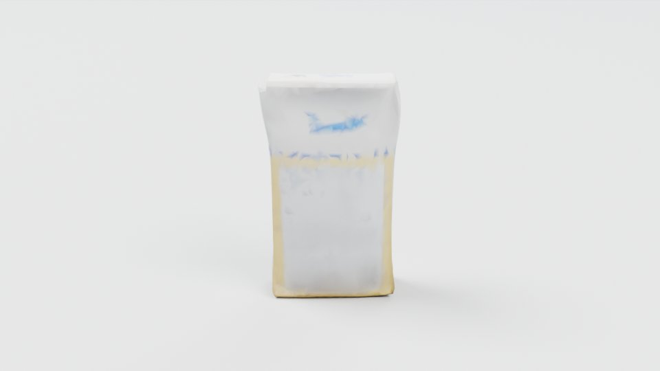

# Blender

Blender is the open-source 3D creation suite. Here its `bpy` module (Blender 4.5) runs in its own `uv` environment,
the inline dependencies of [`motion_studio.py`](motion_studio.py), motion_gen's renderer of an animated GLB scene and
its saved motion; `python -m roboskills.tools.blender` runs it there, and motion_gen's `blender.sh` names that
environment's python. See [SKILL.md](SKILL.md).

## Example

From the repository root, on [`sugar-box.glb`](../../../../assets/example_data/sugar-box.glb) (the
[SAM 3D](../sam3d/README.md#example) example's mesh, decimated to 20,000 faces) and
[`sugar-box-still.npz`](../../../../assets/example_data/sugar-box-still.npz) (30 still frames framing it):

```sh
uv run python -m roboskills.tools.blender assets/example_data/sugar-box.glb assets/example_data/sugar-box-still.npz \
  --out runs/examples/blender --frames 0 --view=-90,20
```



`blender/0000.png`, `sheet.png` and `render.json`: frame 0 in Cycles at 960×540, 32 samples. About 2 s on an
RTX A6000 once its environment is made.

## Reference

Blender has no paper to cite; cite the software: [Blender](https://www.blender.org) (Blender Foundation),
[source](https://projects.blender.org/blender/blender), [Python API 4.5](https://docs.blender.org/api/4.5/).
