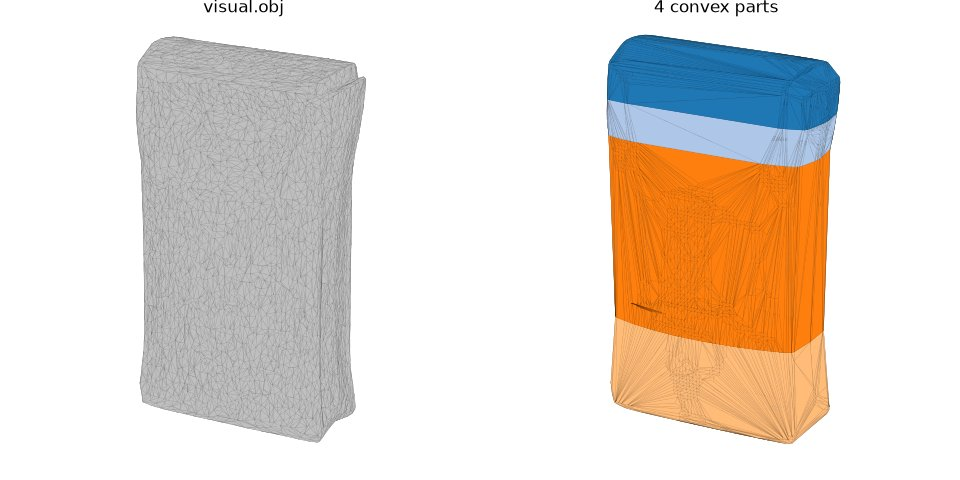

# CoACD

CoACD decomposes a mesh into approximately convex parts, measuring concavity in a collision-aware way and choosing
cuts by tree search. Here `python -m roboskills.tools.coacd --mesh M --out DIR` writes a decimated visual mesh and
convex hulls in the mesh's frame for MuJoCo mesh geoms, on the CPU. See [SKILL.md](SKILL.md).

## Example

From the repository root, on the [SAM 3D](../sam3d/README.md#example) example's mesh:

```sh
uv run python -m roboskills.tools.coacd --mesh runs/examples/sugar-box/shape/mesh.ply --out runs/examples/sugar-box/collision
```



`collision/visual.obj` and its 32 convex parts `part_*.obj`, in the mesh's frame. About 10 s on the CPU.

## Reference

Xinyue Wei et al., "Approximate Convex Decomposition for 3D Meshes with Collision-Aware Concavity and Tree Search",
ACM Transactions on Graphics 41(4), SIGGRAPH 2022. [Paper](https://arxiv.org/abs/2205.02961) ·
[Code](https://github.com/SarahWeiii/CoACD) · [Project](https://colin97.github.io/CoACD/)

```bibtex
@article{wei2022coacd,
  title={Approximate convex decomposition for 3d meshes with collision-aware concavity and tree search},
  author={Wei, Xinyue and Liu, Minghua and Ling, Zhan and Su, Hao},
  journal={ACM Transactions on Graphics (TOG)},
  volume={41},
  number={4},
  pages={1--18},
  year={2022},
  publisher={ACM New York, NY, USA}
}
```
