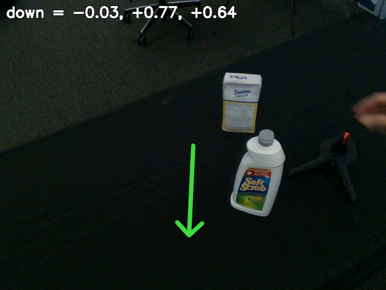

# GeoCalib

GeoCalib estimates a single image's camera intrinsics and gravity direction, combining a learned network with
geometric optimization. Here `python -m roboskills.tools.geocalib --video V --out gravity/` writes the gravity
direction in the OpenCV camera frame, the median over eight frames. See [SKILL.md](SKILL.md).

## Example

From the repository root, on [`sugar-box.mp4`](../../../../assets/example_data/sugar-box.mp4):

```sh
uv run python -m roboskills.tools.geocalib --video assets/example_data/sugar-box.mp4 --out runs/examples/sugar-box/gravity
```



`gravity/gravity.json`: `down` in the camera frame (x right, y down, z forward), drawn from the image centre. About 5 s.

## Reference

Alexander Veicht et al., "GeoCalib: Single-image Calibration with Geometric Optimization", ECCV 2024.
[Paper](https://arxiv.org/abs/2409.06704) · [Code](https://github.com/cvg/GeoCalib)

```bibtex
@inproceedings{veicht2024geocalib,
  author    = {Alexander Veicht and
               Paul-Edouard Sarlin and
               Philipp Lindenberger and
               Marc Pollefeys},
  title     = {{GeoCalib: Single-image Calibration with Geometric Optimization}},
  booktitle = {ECCV},
  year      = {2024}
}
```
