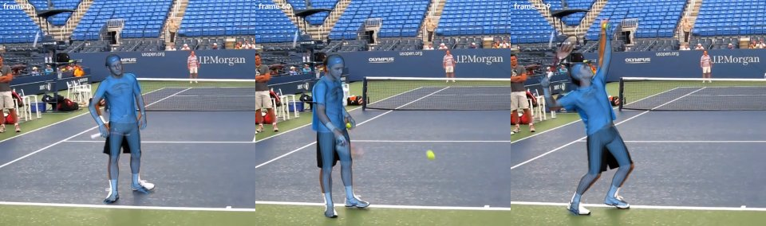

# GVHMR

GVHMR recovers a person's world-grounded SMPL-X body motion from a monocular video, regressing it in gravity-view
coordinates. Here `python -m roboskills.tools.gvhmr --video V --out motion/` runs `gvhmr.recover` in its own `uv`
environment and writes the SMPL-X parameters; motion_gen's `gvhmr.sh` names that environment's python. See [SKILL.md](SKILL.md).

## Example

From the repository root, on [`tennis.mp4`](../../../../assets/example_data/tennis.mp4) (4 s of GVHMR's demo clip,
812×720 at 30 fps; SMPL-X in `~/.robokit/body_models/smplx`):

```sh
uv run python -m roboskills.tools.gvhmr --video assets/example_data/tennis.mp4 \
  --out runs/examples/tennis/motion
```



`motion/smplx.npz`: 120 frames of SMPL-X parameters, the `camera_*` ones drawn over the video. About 3 min on an RTX
A6000, most of it the first call's 5.2 GB of checkpoints.

## Reference

Zehong Shen et al., "World-Grounded Human Motion Recovery via Gravity-View Coordinates", SIGGRAPH Asia 2024.
[Paper](https://arxiv.org/abs/2409.06662) · [Code](https://github.com/zju3dv/GVHMR) ·
[Project](https://zju3dv.github.io/gvhmr)

```bibtex
@inproceedings{shen2024gvhmr,
  title={World-Grounded Human Motion Recovery via Gravity-View Coordinates},
  author={Shen, Zehong and Pi, Huaijin and Xia, Yan and Cen, Zhi and Peng, Sida and Hu, Zechen and Bao, Hujun and Hu, Ruizhen and Zhou, Xiaowei},
  booktitle={SIGGRAPH Asia Conference Proceedings},
  year={2024}
}
```
