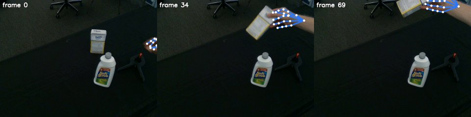

# HaWoR

HaWoR reconstructs world-space hand motion (MANO) from egocentric videos. Here
`python -m roboskills.tools.hawor --video V --masks masks/ --depth depth/depth.npz --out hands/` runs it in the
`roboskills-hawor` image and writes one hand's MANO joints and vertices per frame in the camera frame.
See [SKILL.md](SKILL.md).

## Example

From the repository root, on [`sugar-box.mp4`](../../../../assets/example_data/sugar-box.mp4), after the [SAM
3](../sam3/README.md#example) and [MoGe-3](../moge3/README.md#example) examples (and `docker/weights.sh hawor` once;
MANO in `~/.robokit/body_models/mano`):

```sh
uv run python -m roboskills.tools.hawor --video assets/example_data/sugar-box.mp4 --masks runs/examples/sugar-box/masks \
  --depth runs/examples/sugar-box/depth/depth.npz --out runs/examples/sugar-box/hands
```



`hands/hands.npz`: the right hand's 21 MANO joints in every frame it is seen, projected with MoGe-3's `K`. About 11 s on
an RTX A6000.

## Reference

Jinglei Zhang et al., "HaWoR: World-Space Hand Motion Reconstruction from Egocentric Videos", CVPR 2025.
[Paper](https://arxiv.org/abs/2501.02973) · [Code](https://github.com/ThunderVVV/HaWoR)

```bibtex
@article{zhang2025hawor,
  title={HaWoR: World-Space Hand Motion Reconstruction from Egocentric Videos},
  author={Zhang, Jinglei and Deng, Jiankang and Ma, Chao and Potamias, Rolandos Alexandros},
  journal={arXiv preprint arXiv:2501.02973},
  year={2025}
}
```
