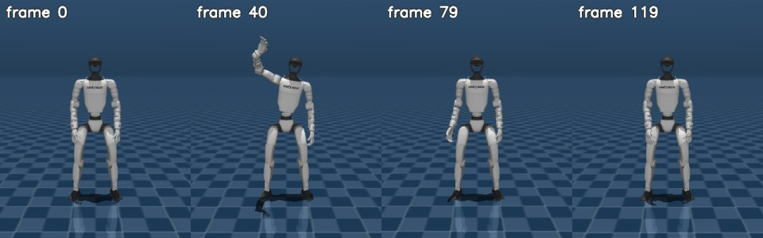

# Kimodo

Kimodo is a kinematic motion diffusion model that generates human and robot motions from text prompts and
constraints such as keyframes and paths. Here `python -m roboskills.tools.kimodo --prompt P --out motion/` runs
`kimodo.scripts.generate` in its own `uv` environment for Unitree G1 (Kimodo-G1-RP-v1) or SOMA skeleton motion;
motion_gen's `kimodo.sh` names that environment's python.
See [SKILL.md](SKILL.md).

## Example

From the repository root (a Hugging Face token with Llama 3 access in `~/.cache/huggingface/token`):

```sh
uv run python -m roboskills.tools.kimodo --prompt "a person waves with the right hand" \
  --out runs/examples/kimodo
```



`motion.csv` and `motion.npz`: 4 s of Unitree G1 motion at 30 fps, here played on Kimodo's G1 model in MuJoCo. About 3
min on an RTX A6000 including the first call's downloads, the prompt encoded in process.

## Reference

Davis Rempe et al., "Kimodo: Scaling Controllable Human Motion Generation", arXiv 2026.
[Paper](https://arxiv.org/abs/2603.15546) · [Code](https://github.com/nv-tlabs/kimodo) ·
[Project](https://research.nvidia.com/labs/sil/projects/kimodo/)

```bibtex
@article{Kimodo2026,
  title={Kimodo: Scaling Controllable Human Motion Generation},
  author={Rempe, Davis and Petrovich, Mathis and Yuan, Ye and Zhang, Haotian and Peng, Xue Bin and Jiang, Yifeng and Wang, Tingwu and Iqbal, Umar and Minor, David and de Ruyter, Michael and Li, Jiefeng and Tessler, Chen and Lim, Edy and Jeong, Eugene and Wu, Sam and Hassani, Ehsan and Huang, Michael and Yu, Jin-Bey and Chung, Chaeyeon and Song, Lina and Dionne, Olivier and Kautz, Jan and Yuen, Simon and Fidler, Sanja},
  journal={arXiv:2603.15546},
  year={2026}
}
```
