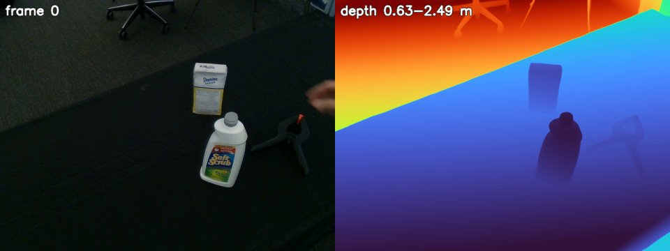

# MoGe-3

MoGe-3 estimates metric geometry (point map, depth and camera field of view) from a single image, refining fine
detail with sparse volumetric refinement. Here `python -m roboskills.tools.moge3 --video V --out depth/` writes metric
depth and pinhole intrinsics for every video frame, reusing the reference frame's field of view.
See [SKILL.md](SKILL.md).

## Example

From the repository root, on [`sugar-box.mp4`](../../../../assets/example_data/sugar-box.mp4):

```sh
uv run python -m roboskills.tools.moge3 --video assets/example_data/sugar-box.mp4 --out runs/examples/sugar-box/depth
```



`depth/depth.npz`: metric depth for all 70 frames and one pinhole `K` (frame 0 shown). About 20 s on an RTX A6000 with
the weights cached.

## Reference

Lingyu Kong et al., "MoGe-3: Fine-Detail Monocular Geometry Estimation with Self-Guided Sparse Volumetric
Refinement", arXiv 2026. [Paper](https://arxiv.org/abs/2607.17967) · [Code](https://github.com/microsoft/MoGe) ·
[Project](https://qft-333.github.io/moge3page/)

```bibtex
@misc{kong2026finedetailmonoculargeometryestimation,
      title={Fine-Detail Monocular Geometry Estimation with Self-Guided Sparse Volumetric Refinement},
      author={Lingyu Kong and Ruicheng Li and Ruicheng Wang and Sicheng Xu and Chengtang Yao and Jianfeng Xiang and Jiaolong Yang},
      year={2026},
      eprint={2607.17967},
      archivePrefix={arXiv},
      primaryClass={cs.CV},
      url={https://arxiv.org/abs/2607.17967},
}
```
