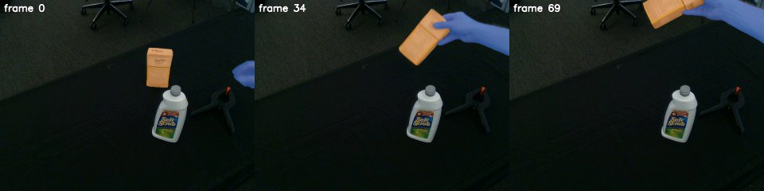

# SAM 3

SAM 3 (Segment Anything with Concepts) detects, segments and tracks every instance of a noun-phrase prompt in images
and videos. Here `Sam().detect(rgb, prompts)` returns masks per image with the model kept loaded, and
`python -m roboskills.tools.sam3 --video V --prompts ... --out masks/` tracks them through a video into indexed PNGs.
See [SKILL.md](SKILL.md).

## Example

From the repository root, on [`sugar-box.mp4`](../../../../assets/example_data/sugar-box.mp4) (70 frames at 640×480: a
right hand picks up a sugar box):

```sh
uv run python -m roboskills.tools.sam3 --video assets/example_data/sugar-box.mp4 --prompts "sugar box" "right hand" \
  --out runs/examples/sugar-box/masks
```



`masks/00000.png` ... `00069.png`: the sugar box (label 1, orange) and the right hand (label 2, blue), tracked from
frame 0, and `masks/objects.json`. About 1 min on an RTX A6000 with the weights cached.

## Reference

Nicolas Carion et al., "SAM 3: Segment Anything with Concepts", arXiv 2025.
[Paper](https://arxiv.org/abs/2511.16719) · [Code](https://github.com/facebookresearch/sam3)

```bibtex
@misc{carion2025sam3segmentconcepts,
      title={SAM 3: Segment Anything with Concepts},
      author={Nicolas Carion and Laura Gustafson and Yuan-Ting Hu and Shoubhik Debnath and Ronghang Hu and Didac Suris and Chaitanya Ryali and Kalyan Vasudev Alwala and Haitham Khedr and Andrew Huang and Jie Lei and Tengyu Ma and Baishan Guo and Arpit Kalla and Markus Marks and Joseph Greer and Meng Wang and Peize Sun and Roman Rädle and Triantafyllos Afouras and Effrosyni Mavroudi and Katherine Xu and Tsung-Han Wu and Yu Zhou and Liliane Momeni and Rishi Hazra and Shuangrui Ding and Sagar Vaze and Francois Porcher and Feng Li and Siyuan Li and Aishwarya Kamath and Ho Kei Cheng and Piotr Dollár and Nikhila Ravi and Kate Saenko and Pengchuan Zhang and Christoph Feichtenhofer},
      year={2025},
      eprint={2511.16719},
      archivePrefix={arXiv},
      primaryClass={cs.CV},
      url={https://arxiv.org/abs/2511.16719},
}
```
