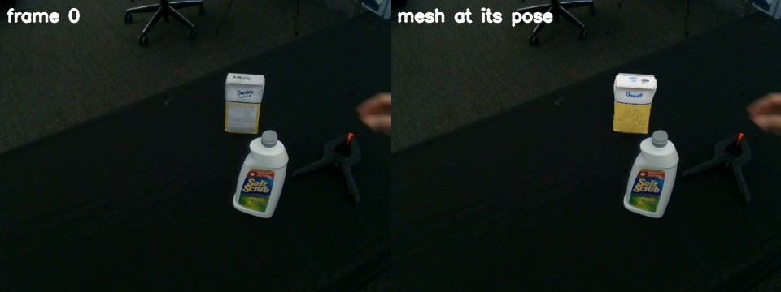

# SAM 3D

SAM 3D Objects reconstructs an object's 3D shape, texture and pose from a single image and its mask. Here
`python -m roboskills.tools.sam3d --video V --masks masks/ --depth depth/depth.npz --out shape/` runs it in the
`roboskills-sam3d` image on one frame with MoGe's point map and writes the object's mesh and camera pose.
See [SKILL.md](SKILL.md).

## Example

From the repository root, on [`sugar-box.mp4`](../../../../assets/example_data/sugar-box.mp4), after the [SAM
3](../sam3/README.md#example) and [MoGe-3](../moge3/README.md#example) examples (and `docker/weights.sh sam3d` once):

```sh
uv run python -m roboskills.tools.sam3d --video assets/example_data/sugar-box.mp4 --masks runs/examples/sugar-box/masks \
  --depth runs/examples/sugar-box/depth/depth.npz --out runs/examples/sugar-box/shape
```



`shape/mesh.ply` and `shape/pose.json`: the sugar box's mesh, its vertex colours drawn at `camera_from_object` over
frame 0. 4 min on a free RTX 3090 (229 s), 8.9 GiB in use at most (8.44 GiB peak allocation): the models wait on
the CPU and only the mesh is decoded. `--gaussians` also writes `shape/gaussians.ply` (the same peak);
`--no-offload` keeps every model on the GPU (17.3 GiB).

## Reference

SAM 3D Team (Xingyu Chen et al.), "SAM 3D: 3Dfy Anything in Images", arXiv 2025.
[Paper](https://arxiv.org/abs/2511.16624) · [Code](https://github.com/facebookresearch/sam-3d-objects)

```bibtex
@article{sam3dteam2025sam3d3dfyimages,
      title={SAM 3D: 3Dfy Anything in Images},
      author={SAM 3D Team and Xingyu Chen and Fu-Jen Chu and Pierre Gleize and Kevin J Liang and Alexander Sax and Hao Tang and Weiyao Wang and Michelle Guo and Thibaut Hardin and Xiang Li and Aohan Lin and Jiawei Liu and Ziqi Ma and Anushka Sagar and Bowen Song and Xiaodong Wang and Jianing Yang and Bowen Zhang and Piotr Dollár and Georgia Gkioxari and Matt Feiszli and Jitendra Malik},
      year={2025},
      eprint={2511.16624},
      archivePrefix={arXiv},
      primaryClass={cs.CV},
      url={https://arxiv.org/abs/2511.16624},
}
```
