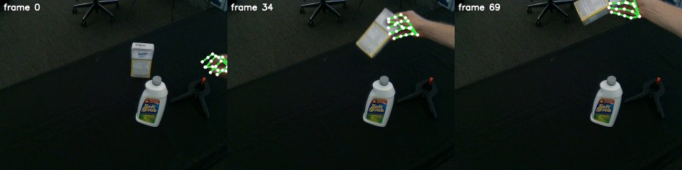

# WiLoR

WiLoR localizes hands in an image with a real-time detector and reconstructs each one as a MANO hand, refined from
multi-scale image features. Here `python -m roboskills.tools.wilor --video V --out hands/` runs it in its own `uv`
environment on every frame and writes each detected hand's MANO parameters and keypoints. See [SKILL.md](SKILL.md).

## Example

From the repository root, on [`sugar-box.mp4`](../../../../assets/example_data/sugar-box.mp4) (MANO in
`~/.robokit/body_models/mano`; the first call makes WiLoR's checkout and weights in `~/.roboskills/weights/wilor`):

```sh
uv run python -m roboskills.tools.wilor --video assets/example_data/sugar-box.mp4 --out runs/examples/sugar-box/wilor
```



`wilor/hands.npz`: one row per detected hand (here the right hand in all 70 frames) with MANO's turns and its 21
keypoints, drawn in image pixels. About 10 s on an RTX A6000.

## Reference

Rolandos Alexandros Potamias et al., "WiLoR: End-to-end 3D Hand Localization and Reconstruction in-the-wild",
CVPR 2025. [Paper](https://arxiv.org/abs/2409.12259) · [Code](https://github.com/rolpotamias/WiLoR) ·
[Project](https://rolpotamias.github.io/WiLoR/)

```bibtex
@article{potamias2024wilor,
  title={WiLoR: End-to-end 3D Hand Localization and Reconstruction in-the-wild},
  author={Potamias, Rolandos Alexandros and Zhang, Jinglei and Deng, Jiankang and Zafeiriou, Stefanos},
  journal={arXiv preprint arXiv:2409.12259},
  year={2024}
}
```
